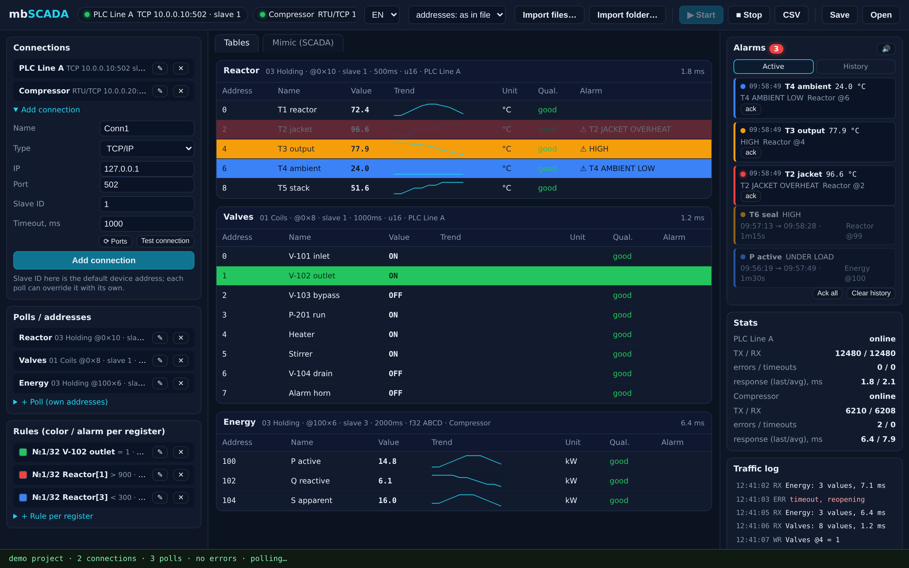
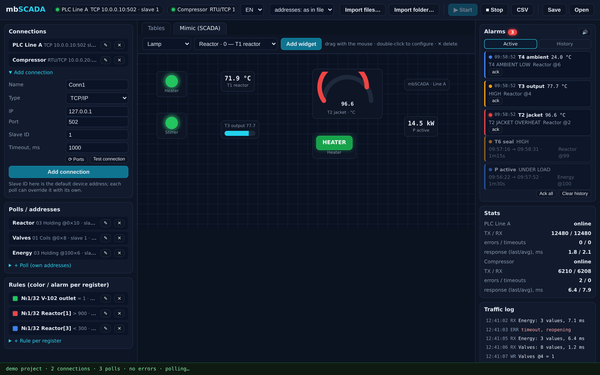

<div align="center">


# 📡 mbSCADA

### Modbus Poll, reimagined — in pure Rust.

**A clean-room Modbus Poll reimplementation with a SCADA mode on top.**
Poll Modbus/TCP & RTU devices into live value tables, import real Modbus Poll `.mbp/.mbw` files byte-exactly,
style any row from a 32-branch rule tree and build mimic diagrams —
all in a ~6 MB single executable. No Modbus Poll sources were read, ever.

[](https://github.com/kostyk348/mbscada-rs/releases/latest)
[](https://github.com/kostyk348/mbscada-rs/actions/workflows/ci.yml)
[](https://github.com/kostyk348/mbscada-rs/actions/workflows/ci.yml)
[](LICENSE)
[](https://rustup.rs/)
[](https://v2.tauri.app/)
[](#-modbus-poll-compatibility)
[](#%EF%B8%8F-feature-tour)
[](https://remade.wiki/projects/mbscada/)

**English** · [Русский](README.ru.md)



</div>

---

## 🧭 TL;DR

- 🖥 **Modbus Poll, but better.** Polls 01/02/03/04, writes 05/06/0F/10, per-poll slave / base-0·1 address / scaling / engineering units — and every connection gets a live traffic log with per-response turnaround.
- 🤝 **Drop-in for your existing configs.** Real Modbus Poll `.mbp` / `.mbw` files import by folder — and a byte-exact round-trip layer (`write(parse(bytes)) == bytes`, proven on real 10.5 files) keeps them intact.
- 🎨 **32 styled branches per row.** The original gives you two colour rules; here every row gets a first-match rule tree with per-branch dynamic row text («0 → Закрыт, 1 → Открыт»).
- 📈 **Trends, alarms, CSV.** Per-row sparklines, hi/hi‑hi/lo/lo‑lo alarms, blink styles — and a one-click CSV value log.
- 🌐 **RU/EN built in.** One switch in the toolbar flips the entire UI; docs ship in both languages.
- ⚡ **Fast & local.** A multithreaded engine (`mb-engine`) drives all connections concurrently; no telemetry, no cloud, nothing leaves the machine.

<details open>
<summary><b>👀 30-second tour</b></summary>

<br>

| | |
|---|---|
| **Live tables + alarm panel** |  |
| **SCADA mimic + widgets** |  |

</details>

## ⬇ Download v1.0.0

Prebuilt installers for every platform — no Rust toolchain needed.
Grab them from [**Releases**](https://github.com/kostyk348/mbscada-rs/releases/latest):

| Platform | Files |
|---|---|
| **Windows** 10/11 x64 | NSIS installer `.exe` · `.msi` |
| **Linux** x86_64 & aarch64 | `.AppImage` (runs anywhere) · `.deb` |
| **macOS** Apple Silicon & Intel | `.dmg` |

> Windows: WebView2 is preinstalled on Win10/11. Linux AppImage bundles its own WebKit.
> Every release is built automatically by GitHub Actions from a `v*` tag — five runners, one commit, all platforms.

## ✨ Feature tour

### 📊 Live tables


- Every poll is an independent **view of the address space**: own function, own register window, own scaling `×mult ÷div +offset`, own 0/1 address base.
- Values render in **Modbus-Poll-style formats**: `u16 / i16 / hex16 / bin16 / ascii16 / u16(swapped)` · `u32 / i32 / hex32` · `float32` in word orders **ABCD / CDAB / BADC / DCBA** · 64-bit `u64 / i64 / f64`.
- **Per-row sparklines** keep the last 40 samples as inline SVG — the last buffer change blinks.
- Click a row to write a value (FC 05/06 for bits, FC 16 for word arrays).

### 🚦 Rules & alarms

- Threshold alarms exactly like Modbus Poll: **hi / hi‑hi / lo / lo‑lo** with messages.
- Styling rules with **up to 32 branches per row** and operators `> ≥ < ≤ = ≠`, in-range / out-of-range, **bit test**.
- First matching branch wins — the classic «Rule 1 over Rule 2» becomes a full priority list.
- **Dynamic row text** per branch: the row label is replaced when a branch fires (state machines live in the table header).
- **Alarm side panel**: active alarms surface as cards — severity, fired-at, live value, message — acknowledge one or all, cleared alarms drop to **history** with durations, optional **beep**, and a click jumps to the table row.

### 🗺 SCADA mode (mimic diagrams)

| | |
|---|---|
|  | Editor with lamps, gauges, bars, live values and **toggle-write buttons** bound to registers — every widget configurable by double-click… plus the **alarm panel** and **traffic log** on the right |

Modbus Poll has no SCADA mode. That is the point of mbSCADA.

### 🤝 Modbus Poll compatibility

- **Import** of `.mbp` (single window) and `.mbw` (workspace with the window list) — one by one or by folder.
- **Byte-exact round-trip** (`mbp_doc`): the file is segmented (`head` / row records / closing marker) and reassembled **bit-for-bit**; editing an alias touches nothing else. Verified byte-exactly against a private real-file corpus produced by Modbus Poll 10.5 (7 files, RU aliases, UTF‑16 markers); CI runs the same test on a public synthetic corpus.
- Format, multiplier, address base, aliases and colours carry over into polls; imported polls bind to **your own connections** (host:port match first, else the first one) — no connections are silently pulled from the files. Each connection carries a default **slave ID** that its polls inherit (a poll may still override it).

<details>
<summary><b>📐 Real corpus layout (reverse-engineered)</b></summary>

```text
[head]                     magic v4=7000 (v5=10010), IP marker (v5), [144][func][addr][qty]
[row record] × qty         marker FF FE FF + len + UTF-16LE alias → PAD 55555555
                           + 6× colour u32 (FF000000 AVG) + zeros
[last row + settings]      the last row's gap holds the settings blob & tail
                           [period][slave][1][0][0][…]
[closing marker]           final empty marker FF FE FF 00 + trailer bytes
```

</details>

## 🚀 Getting started

### Install

Download an installer for your OS from [**Releases**](https://github.com/kostyk348/mbscada-rs/releases/latest) (see the table above), install — and run `mbSCADA`.

### Build from source

**Requirements:** [Rust](https://rustup.rs/) 1.85+, Windows (WebView2 is preinstalled on Win10/11), or Linux with `libudev-dev pkg-config libwebkit2gtk-4.1-dev` for GUI work.

```bash
git clone https://github.com/kostyk348/mbscada-rs.git
cd mbscada-rs
cargo test                # 60 engine tests

# demo slave (no hardware needed): serves registers on 127.0.0.1:502
cargo run -p mb-sim --example demo_server -- 502

# the app (Tauri 2), raw binary
cargo build --release -p mbscada
# → target/release/mbscada

# or full installers for your current OS
cargo install tauri-cli --version '^2'
cargo tauri build
```

Launch `mbSCADA`, «Импорт папки…» your `.mbp` folder and hit **Старт** — real Modbus Poll windows appear as polls and start flowing.

## 🏗 Architecture

```text
┌────────────────────────────────────────────────────────────────────┐
│                    Tauri 2 desktop shell (Rust)                    │
│  src-tauri: dialogs, project JSON, CSV append, engine restarts     │
├────────────────────────────────────────────────────────────────────┤
│  UI (vanilla JS)                                                   │
│  tables · rule editor (32 branches) · SCADA editor · traffic log   │
├────────────────────────────────────────────────────────────────────┤
│  crates/                                                           │
│  mb-proto    PDU encode/decode · MBAP · RTU+CRC · ASCII ':'+LRC     │
│  mb-format   .mbp/.mbw parser → lossless MbpDoc → semantic Table    │
│  mb-engine   multithreaded poller: TCP · RTU-serial · RtuOverTcp    │
│              · Ascii-serial · AsciiOverTcp, rules, alarms, trends  │
│  mb-sim      slave simulator (+ demo_server example)               │
└────────────────────────────────────────────────────────────────────┘
```

## 🗺 Roadmap

- ✅ Modbus/TCP, RTU, RTU-over-TCP transports with per-connection traffic log (v0.1)
- ✅ Import `.mbp`/`.mbw` by file and by folder (v0.1)
- ✅ 32-branch styled rules + dynamic row text — UI and engine (v0.2)
- ✅ Display formats through 64-bit: hex32 / ascii16 / u16‑swapped / u64 / i64 / f64 (v0.3)
- ✅ Byte-exact `.mbp` round-trip on a real corpus (v0.4)
- ✅ Modbus ASCII framing + ASCII serial & over-TCP transports (v0.4)
- ✅ Per-row sparklines + CSV value log (v0.4)
- ✅ In-place editing of connections / polls / rules; per-connection default slave ID; imports bound to your own connections (v1.0)
- ✅ Prebuilt release bundles: Windows x64, Linux x86_64 + aarch64, macOS Intel + Apple Silicon (v1.0)
- ✅ Alarm side panel (ack, history, sound, jump-to-row) + SCADA gauge / toggle-write widgets (v1.1)
- ✅ One-click RU/EN UI switch, bilingual docs, refreshed screenshots (v1.1)
- ⬜ `.mbp` writer in the UI — «Save as Modbus Poll» (round-trip layer is already engine-side)
- ⬜ Per-row trend window (bigger than a sparkline)

## ⁇ FAQ

**Is this a Modbus Poll rip-off?**
No. This is a **clean-room** implementation: the wire protocol is public spec, and the `.mbp` layout was learned from byte-level analysis of files produced by Modbus Poll 10.5 — no proprietary source code was touched.

**What "byte-exact round-trip" means for me?**
Your Modbus Poll files go in, everything else comes back identical. mbSCADA can edit aliases without regenerating the whole file, so unedited bytes stay exactly as Modbus Poll wrote them.

**Does it talk to my devices today?**
TCP / RTU / RTU-over-TCP are production paths with integration tests. ASCII framing and its serial / over-TCP transports are implemented and unit-tested; wire-side integration testing on real devices is on the roadmap.

**Why Rust?**
One executable, no runtime, memory-safe poller — and the whole engine is testable headlessly (see `cargo test`).

## 🤝 Contributing

Issues and PRs welcome. The engine is test-first: `crates/mb-engine`, `crates/mb-format` / `crates/mb-proto` all have unit suites covering Tauri-free paths — start there.

<div align="center">


**mbSCADA** — Modbus Poll for people who also want SCADA.

[Download](https://github.com/kostyk348/mbscada-rs/releases/latest) · [Build it](#-getting-started) · [Roadmap](#-roadmap) · [License (MIT)](LICENSE)

</div>
