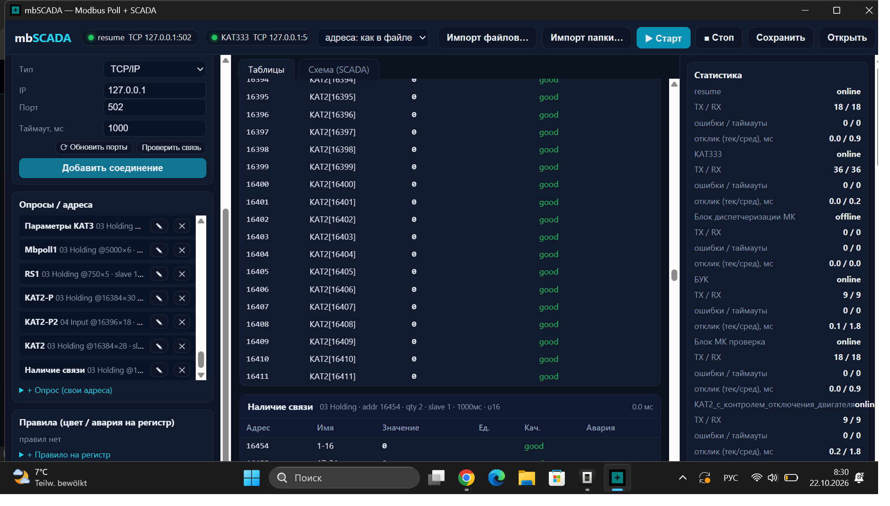
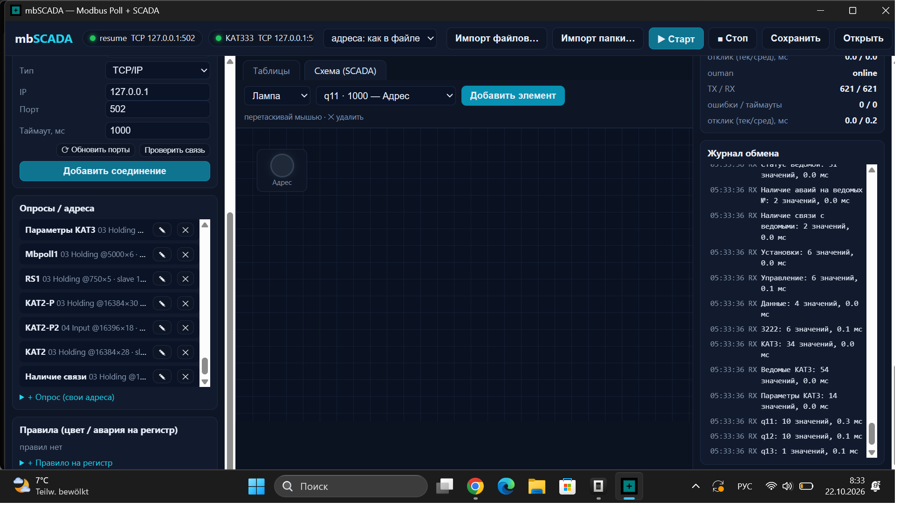
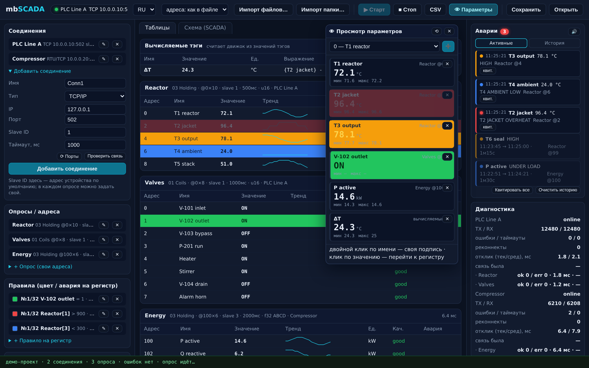
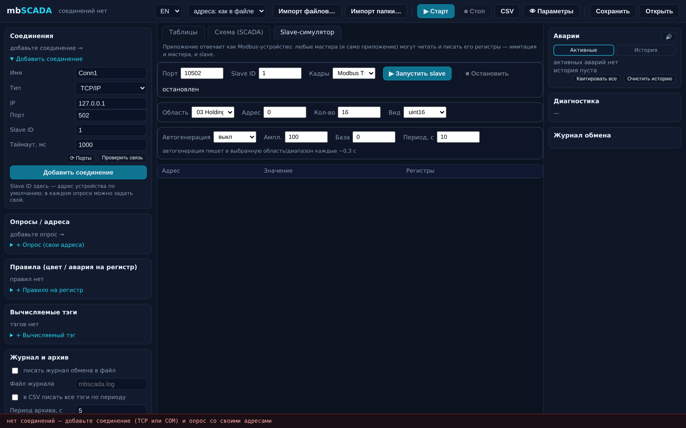

<div align="center">


# 📡 mbSCADA

### Modbus Poll, reimagined — in pure Rust.

**Чистая (clean-room) реализация Modbus Poll со SCADA-режимом сверху.**
Опрос Modbus/TCP и RTU в живые таблицы значений, байт-в-битный импорт настоящих `.mbp/.mbw` Modbus Poll, стилевые правила деревом из 32 веток на строку и мимик-схемы —
всё в одном exe (~6 МБ). Чужой исходный код не читался, никогда.

[](https://github.com/kostyk348/mbscada-rs/releases/latest)
[](https://github.com/kostyk348/mbscada-rs/actions/workflows/ci.yml)
[](https://github.com/kostyk348/mbscada-rs/actions/workflows/ci.yml)
[](LICENSE)
[](https://rustup.rs/)
[](https://v2.tauri.app/)
[](#-совместимость-с-modbus-poll)
[](#-тур-по-возможностям)

**Русский** · [English](README.md)
**🌐 Сайт проекта:** [kostyk348.github.io/mbscada-rs](https://kostyk348.github.io/mbscada-rs/)




</div>

---

## 🧭 Коротко

- 🖥 **Modbus Poll, только лучше.** Чтение 01/02/03/04, запись 05/06/0F/10, свой slave / база адресов 0·1 / шкалирование / единицы на каждый опрос — и у каждого соединения свой журнал обмена с временем отклика.
- 🤝 **Заменяет вряд ли, но встаёт рядом сразу.** Реальные файлы `.mbp / .mbw` Modbus Poll импортируются по папке — и слой байт-в-битного round-trip (`write(parse(bytes)) == bytes`, проверено на реальных файлах 10.5) сохраняет их целыми.
- 🎨 **32 стилевых ветки на строку.** В оригинале — два цветовых правила; здесь — дерево первого совпадения на любую строку с динамическим текстом ветки («0 → Закрыт, 1 → Открыт»).
- 📈 **Тренды, аварии, CSV.** Спарклайны по строкам, аварии hi/hi‑hi/lo/lo‑lo, мигание — и лог значений в CSV одной кнопкой.
- 👁 **Окно просматриваемых параметров.** Закрепите регистры, которые реально смотрите, — или вычисляемые тэги — в плавающем окне с крупными живыми значениями, цветами аварий и min/max за сессию (v1.2).
- 🧪 **Симулятор Slave + типизированные значения.** Приложение может отвечать как Modbus-устройство на TCP-порту — опрашивайте его любым мастером (или самим собой): редактируемая сетка регистров, автогенерация синус/пила/шум, кадры TCP и RTU-over-TCP. Значения показываются и пишутся **вперемешку real / int / uint** — float32/64 со всеми четырьмя порядками слов, 32/64-битные целые, hex/bin — типизированные окна записи и цикл отображения ячейки dec → hex → bin (v1.3).
- 🧮 **Вычисляемые тэги.** Арифметика над тэгами — `{T2 jacket} - {T1 reactor}`, `min(...)`, `pow(...)` — движок считает на каждом скане и показывает в своей таблице (v1.1).
- 🗄 **Журнал + архив + диагностика.** События движка (RX/WR/ERR/SYS) дописываются в лог-файл, настраиваемый CSV-архив (по изменениям или по периоду), диагностика по соединениям и опросам со счётчиками реконнектов (v1.1).
- 🌐 **Русский и English из коробки.** Один переключатель в тулбаре — и весь интерфейс на другом языке; документация тоже двуязычная.
- ⚡ **Быстро и локально.** Многопоточный движок опрашивает все соединения параллельно; без сети, без телеметрии, без облака.

<details open>
<summary><b>👀 Быстрый тур</b></summary>

<br>

| | |
|---|---|
| **Живые таблицы + панель аварий** |  |
| **SCADA-схема + виджеты** |  |
| **Окно просматриваемых параметров** |  |

</details>

## ⬇ Скачать v1.3.0

Готовые установщики под все платформы — тулчейн не нужен.
Забирайте из [**Releases**](https://github.com/kostyk348/mbscada-rs/releases/latest):

| Платформа | Файлы |
|---|---|
| **Windows** 10/11 x64 | установщик NSIS `.exe` · `.msi` |
| **Linux** x86_64 и aarch64 | `.AppImage` (запускается везде) · `.deb` |
| **macOS** Apple Silicon и Intel | `.dmg` |

> Windows: WebView2 уже предустановлен в Win10/11. Linux AppImage несёт свой WebKit.
> Каждый релиз собирается автоматически GitHub Actions из тега `v*` — пять раннеров, один коммит, все платформы.

## ✨ Тур по возможностям

### 📊 Живые таблицы


- Каждый опрос — независимый **взгляд на адресное пространство**: своя функция, окно регистров, своё шкалирование `×mult ÷div +offset`, своя база 0/1.
- Значения отображаются в форматах как в Modbus Poll: `u16 / i16 / hex16 / bin16 / ascii16 / u16(swapped)` · `u32 / i32 / hex32` · `float32` во всех порядках слов **ABCD / CDAB / BADC / DCBA** · 64-битные `u64 / i64 / f64`.
- **Спарклайны по строкам** держат последние 40 отсчётов — последний изменённый буфер мигает.
- Клик по строке — запись значения (FC 05/06 для битов, FC 16 для массивов).

### 🚦 Правила и аварии

- Пороговые аварии как в оригинале: **hi / hi‑hi / lo / lo‑lo** с подписями.
- Стилевые правила: до **32 веток на строку**, операторы `> ≥ < ≤ = ≠`, в диапазоне / вне диапазона, **бит-тест**.
- Первый совпавший прайоритет — классическое «Rule 1 раньше Rule 2» превращается в полноценный список приоритетов.
- **Динамический текст строки на ветку**: подпись строки подменяется, когда ветка срабатывает.
- **Боковая панель аварий**: активные аварии выносятся карточками — серьёзность, время, живое значение, подпись; квитирование по одной или все сразу, погасшие уходят в **историю** с длительностью, опциональный **звук**, клик по аварии — переход к строке таблицы.

### 👁 Окно просматриваемых параметров (v1.2)


- Закрепите то, что реально смотрите, — **любой регистр любого опроса или вычисляемый тэг** — в плавающем окне поверх рабочего поля (кнопка 👁 Параметры в тулбаре).
- Крупные живые значения в инженерных единицах, расцветка из дерева правил (цвет/фон аварии наследуются от строки таблицы), **min/max** за сессию по каждой карточке, признак качества и «нет связи».
- Состав окна хранится **в проекте** (сохраняется/открывается вместе с ним), позиция окна — на рабочей станции. Двойной клик по карточке — своя подпись, ✕ — убрать, ⟲ — сбросить min/max, клик по значению — переход к строке таблицы.

### 🧪 Симулятор Slave и типизированные значения (v1.3)



> 📖 **Полный гайд по симулятору**: [`docs/guide-slave-ru.md`](docs/guide-slave-ru.md) — быстрый старт, подключение мастеров, типы данных, отображение dec/hex/bin, готовые сценарии и решение проблем.

- **Обе стороны кабеля в одном приложении.** Новая вкладка *Slave-симулятор* обслуживает coils / discrete / holding / input регистры по Modbus TCP или RTU-over-TCP — наведите любой мастер на `localhost:10502` или опрашивайте самим mbSCADA.
- **Живая сетка регистров** с типизированным видом (u16 / i16 / hex / u32 / i32 / float CDAB·ABCD): правите ячейку — модель данных slave меняется сразу; для битовых областей — чекбоксы; рядом с типизированным значением показываются сырые биты регистров.
- **Автогенерация** (синус / пила / шум с амплитудой, базой и периодом) оживляет выбранный диапазон — правилам аварий, трендам и мимике есть что переваривать.
- **Типизированные значения везде.** У каждого опроса есть тип данных — быстрый селектор прямо на карточке таблицы (один клик после импорта `.mbp`). Окна записи сами пакуют значение в регистры: float → два слова с нужным порядком, i16 → допкод, hex/bin принимаются как `0x…`/`0b…`.
- **Отображение в ячейке**: ПКМ по любому значению — цикл dec → hex → bin (для строки), или задайте формат по умолчанию для всего опроса.
- **Переработка UI под капотом**: таблицы, мимика и журнал теперь обновляются точечно вместо перестроения DOM каждые 300 мс — ушли лаги и рвущиеся двойные клики.

### 🗺 SCADA-режим (мимик-схемы)

| | |
|---|---|
|  | Редактор с лампами, гейджами, полосами, живыми значениями и **кнопками-тумблерами с записью**, привязанными к регистрам — каждый виджет настраивается двойным кликом… плюс **панель аварий** и **журнал обмена** справа |

В Modbus Poll SCADA-режима нет. В этом и смысл mbSCADA.

### 🧮 Вычисляемые тэги, журнал, архив и диагностика (v1.1)

- **Вычисляемые (виртуальные) тэги**: безопасный вычислитель выражений прямо в движке — ссылки `{по имени тэга}`, псевдонимы `p<опрос>:<адрес>`, операции `+ - * / % ^`, функции `min / max / avg / abs / sqrt / round / floor / ceil / pow`. Результаты живут в своей таблице над опросами (единицы и сообщения об ошибках — на месте), и попадают в CSV-архив вместе с живыми тэгами.
- **Журнал событий в файл**: движок дописывает каждую строку RX / WR / ERR / SYS (с полной датой и временем) в файл, настроенный в «Журнал и архив», — постоянный протокол обмена рядом со встроенным журналом.
- **Настраиваемый CSV-архив**: режим «только изменения» (строка при смене значения) или «все тэги по периоду»; файл сохраняется в проекте и автоматически возобновляется при запуске.
- **Панель диагностики**: по соединению — TX/RX, ошибки/таймауты, **реконнекты**, отклик тек/сред, как давно был последний успешный обмен, последняя ошибка; по каждому опросу — счётчики ok/err и свой отклик.

### 🤝 Совместимость с Modbus Poll

- **Импорт** `.mbp` (одиночное окно) и `.mbw` (workspace со списком окон) — по одному или целой папкой.
- **Байт-в-битный round-trip** (`mbp_doc`): файл разбирается на сегменты (`head` / записи строк / закрывающий маркер) и собирается **побайтно**; правка alias не задевает ни один другой байт. Проверено побайтно на приватном корпусе реальных файлов Modbus Poll 10.5 (7 файлов, русские алиасы, UTF‑16 маркеры); в CI гоняется тот же тест на публичной синтетике.
- Формат, множитель, база, алиасы и цвета переносятся в опросы; импортированные опросы привязываются к **вашим соединениям** (сначала по совпадению host:port, иначе первое) — соединения из файлов не подхватываются. У каждого соединения есть свой **Slave ID** по умолчанию, который наследуют его опросы (опрос может переопределить).

<details>
<summary><b>📐 Разбор реального макета оригинала</b></summary>

```text
[head]                     magic v4=7000 (v5=10010), IP-маркер (v5), [144][func][addr][qty]
[row record] × qty         маркер FF FE FF + длина + UTF-16LE алиас → PAD 55555555
                           + 6× u32 цвета (FF000000) + нули
[последняя строка + настройки]  гэп последней строки хранит blob настроек и хвост
                           [period][slave][1][0][0][…]
[закрывающий маркер]       финальный пустой маркер FF FE FF 00 + трейлерные байты
```

</details>

## 🚀 Сборка и запуск

### Установка

Скачайте установщик для своей ОС из [**Releases**](https://github.com/kostyk348/mbscada-rs/releases/latest) (таблица выше), поставьте — и запускайте `mbSCADA`.

### Сборка из исходников

**Требования:** [Rust](https://rustup.rs/) 1.85+, Windows (WebView2 уже в Win10/11) или Linux с `libudev-dev pkg-config libwebkit2gtk-4.1-dev` для GUI.

```bash
git clone https://github.com/kostyk348/mbscada-rs.git
cd mbscada-rs
cargo test                # 68 тестов движка/протокола/формата

# демо-ведомый (без железа): обслуживает регистры на 127.0.0.1:502
cargo run -p mb-sim --example demo_server -- 502

# приложение (Tauri 2), чистый бинарник
cargo build --release -p mbscada
# → target/release/mbscada

# или полные установщики под текущую ОС
cargo install tauri-cli --version '^2'
cargo tauri build
```

Запустите `mbSCADA`, «Импорт папки…» свою папку с `.mbp` и жмите **Старт** — окна Modbus Poll станут опросами и потекут.

## 🏗 Архитектура

```text
┌────────────────────────────────────────────────────────────────────┐
│                    Tauri 2 desktop shell (Rust)                    │
│  src-tauri: диалоги, project JSON, CSV-аппенд, рестарты движка     │
├────────────────────────────────────────────────────────────────────┤
│  UI (vanilla JS)                                                   │
│  таблицы · правила (32) · SCADA · окно параметров · журнал         │
├────────────────────────────────────────────────────────────────────┤
│  crates/                                                           │
│  mb-proto    PDU encode/decode · MBAP · RTU+CRC · ASCII ':'+LRC     │
│  mb-format   .mbp/.mbw parser → lossless MbpDoc → semantic Table    │
│  mb-engine   многопоточный опросник: TCP · RTU-serial · RtuOverTcp  │
│              · Ascii-serial · AsciiOverTcp, правила, аварии        │
│  mb-sim      симулятор ведомого (+ пример demo_server)             │
└────────────────────────────────────────────────────────────────────┘
```

## 🗺 Дорожная карта

- ✅ Транспорты Modbus/TCP, RTU, RTU-over-TCP с журналом обмена (v0.1)
- ✅ Импорт `.mbp`/`.mbw` файлом и по папке (v0.1)
- ✅ Стилевые правила-32 + динамический текст строки — UI и движок (v0.2)
- ✅ Форматы отображения вплоть до 64-бит: hex32 / ascii16 / u16‑swapped / u64 / i64 / f64 (v0.3)
- ✅ Байт-в-битный round-trip `.mbp` на реальном корпусе (v0.4)
- ✅ Фрейминг Modbus ASCII + транспорты ASCII-serial и over-TCP (v0.4)
- ✅ Спарклайны по строкам + CSV-лог значений (v0.4)
- ✅ Редактирование соединений / опросов / правил на месте; Slave ID по умолчанию в соединении; импорт привязывается к вашим соединениям (v1.0)
- ✅ Готовые релизные сборки: Windows x64, Linux x86_64 + aarch64, macOS Intel + Apple Silicon (v1.0)
- ✅ Панель аварий (квитирование, история, звук, переход к строке) + SCADA-гейдж и кнопка-тумблер (v1.1)
- ✅ Переключатель RU/EN одним кликом, двуязычная документация, свежие скриншоты (v1.1)
- ✅ Вычисляемые тэги: безопасный вычислитель выражений + своя таблица + редактор (v1.1)
- ✅ Журнал событий движка в лог-файл; настраиваемый CSV-архив (по изменениям / по периоду), возобновляется при старте (v1.1)
- ✅ Панель диагностики: статистика ok/err по опросам, счётчики реконнектов, давность последнего успешного обмена (v1.1)
- ✅ Исправлено: цветная дуга SCADA-гейджа вылезала за границу виджета (v1.1)
- ✅ Окно просматриваемых параметров: плавающая панель закреплённых регистров / вычисляемых тэгов — крупные значения, цвета аварий, min/max за сессию, свои подписи, переход к строке (v1.2)
- ✅ Встроенный симулятор slave: эмуляция устройства Modbus TCP / RTU-over-TCP с редактируемой сеткой регистров, типизированным видом и автогенерацией синус/пила/шум (v1.3)
- ✅ Типизированные значения: быстрый селектор типа данных на каждой карточке, типизированные окна записи (float / 32-бит порядки слов, ввод hex/bin), отображение в ячейке dec → hex → bin (v1.3)
- ✅ Исправлено: `regs_per_value` в движке не учитывал порядки слов f32 — float-опросы давали неверные строки (v1.3)
- ✅ Производительность UI: точечные обновления таблиц/мимики/журнала вместо перестроения DOM — двойные клики больше не рвутся перерисовкой (v1.3)
- ⬜ `.mbp`-писатель в UI — «Сохранить как Modbus Poll» (round-trip слой уже в движке)
- ⬜ Окно трендов per-row (больше спарклайна)

## ⁇ FAQ

**Это рип-офф Modbus Poll?**
Нет. Это **clean-room** реализация: протокол — публичная спека, разметка `.mbp` изучена по побайтовому разбору файлов, которые построил Modbus Poll 10.5 — чужие исходники не читались.

**Что для меня значит «байт-в-битный round-trip»?**
Твои файлы Modbus Poll заходят, остальное выходит идентичным. mbSCADA правит alias, не пересобирая весь файл — нетронутые байты остаются ровно теми, что написал Modbus Poll.

**С устройствами оно сегодня разговаривает?**
TCP / RTU / RTU-over-TCP — производственные пути с интеграционными тестами. ASCII-фрейминг и его транспорты (serial + over-TCP) реализованы и покрыты юнит-тестами; интеграционные испытания на реальных устройствах — в роадмапе.

**Почему Rust?**
Один exe, без рантайма, безопасный по памяти опросник — и весь движок гоняется headless (`cargo test`).

## 🤝 Контрибьютим

Issues и PR welcome. Движок тестовый: `crates/mb-engine`, `crates/mb-format`, `crates/mb-proto` — у всех юнит-комплекты без Tauri. Начни с тестов.

<div align="center">


**mbSCADA** — Modbus Poll для тех, кому нужен ещё и SCADA.

[Скачать](https://github.com/kostyk348/mbscada-rs/releases/latest) · [Собрать](#-сборка-и-запуск) · [Роадмап](#-дорожная-карта) · [Лицензия (MIT)](LICENSE)

</div>
